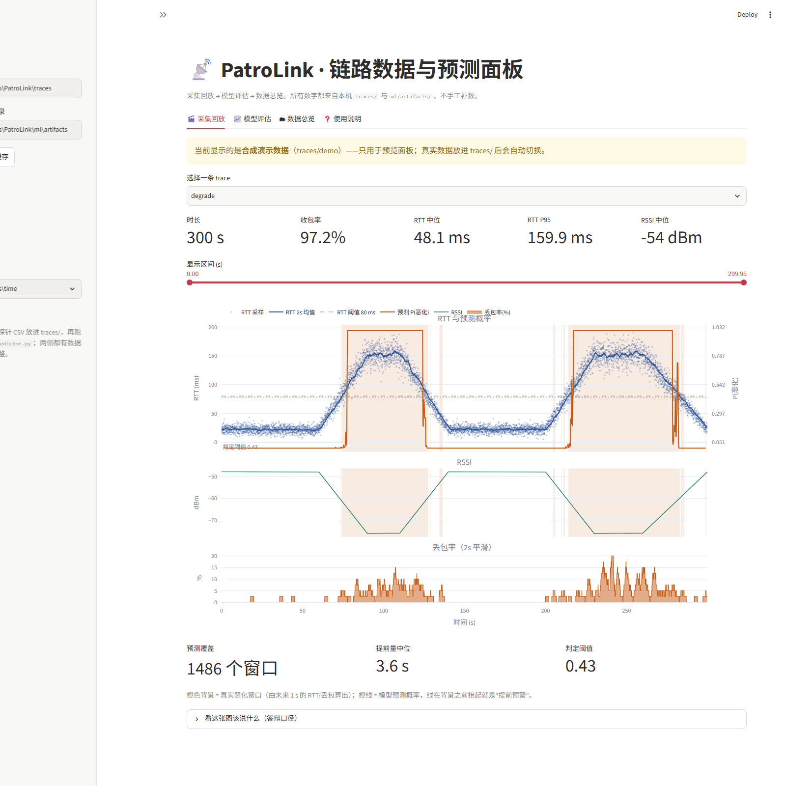

# 可视化面板

Streamlit 面板，用于展示链路采集过程、预测器效果与数据概况。所有曲线均从本地 `traces/` 与 `ml/artifacts/` 计算，不手工补数。



## 1. 启动

```powershell
pip install -r requirements.txt
streamlit run panel/app.py           # 打开 http://localhost:8501
python tools/panel_smoke.py          # 无浏览器冒烟测试（CI 同样执行）
```

停止：终端 `Ctrl+C`。更换端口：`streamlit run panel/app.py --server.port 8502`。

无真实数据时，面板自动读取 `traces/demo/` 的合成数据，并在页面顶部提示"当前为合成演示数据"；真实数据放入 `traces/` 后自动切换。

## 2. 页签

### 采集回放

- 指标栏：时长、收包率、RTT 中位与 P95、RSSI 中位；
- 上：RTT 采样点与 2 s 均值、RTT 阈值线；橙色背景为真实恶化区间；橙线为模型预测概率（右轴）与判定阈值；
- 中：RSSI 曲线；
- 下：丢包率（2 s 平滑）；
- 底部：预测覆盖窗口数、提前量中位、判定阈值；
- 支持切换 trace 与缩放时间窗，用于对比 `good` 与 `wall` 等场景。

### 模型评估

- 模型与基线对比表（AUC / F1 / Recall / PR-AUC）及柱状图；
- 静默 trace 的误报次数/分钟；
- 预测提前量（中位数、P90、事件数）；
- ROC/PR 曲线与"预测概率—真实恶化"时间序列图。

### 数据总览

- `manifest.csv` 记账表与场景覆盖统计；
- 全程良好 trace 少于 2 条时给出提示；
- 数据规模估算（条数、总时长、滑窗样本数）。

### 使用说明

演示流程与面板与后续模块的关系。

## 3. 数据源

| 面板内容 | 数据源 |
|---|---|
| 曲线与场景信息 | `traces/probe_*.csv` 与同名 `.json` |
| 预测概率 | `ml/artifacts/<实验>/model.joblib`（侧边栏选择） |
| 模型评估 | 同目录 `metrics.json`、`roc_pr.png`、`timeseries.png` |
| 记账表 | `traces/manifest.csv` |

没有模型时，采集回放仍显示曲线与真实恶化区间，仅缺少预测概率曲线。

## 4. 故障排查

| 现象 | 原因 | 处理 |
|---|---|---|
| 页面空白或持续加载 | 服务未启动或端口占用 | 检查终端输出；更换端口 |
| 提示为合成演示数据 | `traces/` 中无 `probe_*.csv` | 正常状态；完成采集后自动切换 |
| 无法选择模型 | `ml/artifacts/` 中无 `model.joblib` | 先运行训练脚本 |
| 预测曲线不显示 | 模型与数据的窗口参数不一致 | 使用相同的 `--window/--horizon/--step` 重新训练 |
| 修改目录后未生效 | Streamlit 缓存 | 点击侧边栏"刷新缓存" |
| 提前量显示为空 | 该 trace 无"提前被预测到"的事件 | 正常；或模型未提前发现 |

## 5. 与后续模块的关系

面板当前接入链路与预测数据（Step 2a/4）。接入 `timeline.jsonl` 后，数据源切换为逐帧时间线，页签扩展为"逐帧耗时分解、动作标记、奖励分量"。页面结构可复用，无需重写。
